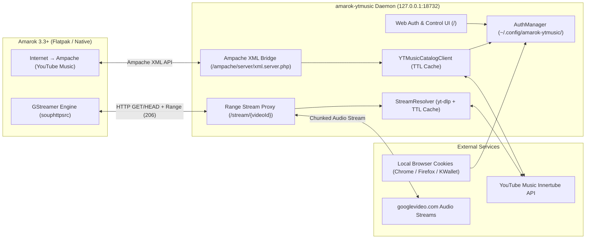

# amarok-ytmusic

**YouTube Music Web-Auth & Streaming Integration for Amarok 3.3+ on KDE Plasma**

`amarok-ytmusic` connects your **YouTube Music** account (Liked Music, Library Songs, Quick Picks, Playlists, Saved Albums, and live catalog search) directly into **Amarok 3.3+** (Flatpak or native) using a local Web Auth dashboard and an HTTP byte-range streaming proxy.

---

## Features

- **Native Amarok Integration (`Ampache (YouTube Music)`)**:
  - Uses Amarok 3.3's compiled C++/KF6 `amarok_service_ampache` plugin—no KF6 C++ compilation required and immune to Amarok 3.3.3's upstream `KPluginMetaData` JS script-loader bug.
  - Browses **★ My Library** (*Liked Music*, *Library Songs*, *Quick Picks & Home*), **♫ My Playlists**, **◎ Saved Albums**, plus live search via Amarok's filter bar.
- **Local Web Authentication Dashboard (`http://127.0.0.1:18732`)**:
  - **1-Click Browser Session Sync**: Sign in at `https://music.youtube.com` in Chrome, Chromium, Firefox, Brave, Vivaldi, or Edge (with full Google 2FA & passkey support) and sync session cookies locally in one click (supports KDE `KWallet 5/6` and `GNOME Keyring`).
  - **Paste Request Headers**: Universal DevTools fallback.
  - **Google OAuth (TV Client)**: Optional device-code flow.
  - All credentials are stored strictly locally in `~/.config/amarok-ytmusic/` with `0600` permissions.
- **Never-Expiring Playlist Streams & GStreamer Seeking**:
  - Every track gets a permanent local proxy URL (`http://127.0.0.1:18732/stream/<videoId>`), so saved Amarok playlists never expire.
  - Resolves fresh YouTube audio URLs just-in-time via `yt-dlp` (with automatic fallback when no external JS runtime is installed, and automatic retry if an upstream signed URL expires with `HTTP 403/410`).
  - Full `HTTP 206 Partial Content` (`Range` / `Accept-Ranges: bytes`) support for smooth seeking in Amarok's GStreamer engine.
- **MPRIS2 Live Sync, Scrobbling, Two-Way Ratings & Lyrics**:
  - Monitors Amarok's `org.mpris.MediaPlayer2.Player` D-Bus interface in real time (`mpris_monitor.py`).
  - **YouTube Music History Scrobbling**: Automatically reports tracks played in Amarok (`>= 15s`) to your YouTube Music listening history so your recommendations stay up to date.
  - **Two-Way Like / Rating Sync**: Rating a playing track 4–5 stars in Amarok (or clicking **♥ Like** in the Web UI / CLI) likes the song on YouTube Music; Liked Music tracks also report 5 stars (`<rating>5</rating>`) to Amarok.
  - **Persistent Ampache IDs**: Saves assigned album/song IDs in `~/.config/amarok-ytmusic/ampache_state.json` so queued tracks and collection IDs survive daemon restarts.
  - **Automated On-Play Metadata, User-Stats & Local Collection Import**:
    - Every time a YouTube Music song is played, automatically fetches & caches rich metadata (`title`, `artist`, `album`, `year`, high-res cover art, lyrics, `likeStatus`, `inLibrary`) plus user playback statistics (`play_count`, `score`, `first_played`, `last_played`) in SQLite (`~/.config/amarok-ytmusic/metadata_cache.db`).
    - Caches your user profile info locally so dashboard loads are instant.
    - Automatically downloads and embeds full MP4 metadata (`©nam`, `©ART`, `©alb`, `©day`, `©lyr`, `covr` cover art, `©cmt=ytmusic:<videoId>`, and Amarok's native `FMPS_Rating`, `FMPS_Playcount`, `FMPS_Rating_Amarok_Score` atoms) into `~/Music/YouTube Music/<Artist>/<Album>/<Title>.m4a`—which Amarok's Local Collection automatically picks up so you get **real Cover Art, real Artist/Album, clickable Stars, Play Count, Score, and Last Played** natively inside Amarok (and instant zero-latency replay on `/stream/<videoId>`!).
  - **Live Lyrics**: View lyrics for the currently playing Amarok track from the Web UI (`http://127.0.0.1:18732`) or CLI (`amarok-ytmusic lyrics`).
- **Future-Ready `ScriptableService` Included**:
  - Also ships `amarok_script/` (`main.js`, `script.json`, `script.spec`) and an atomic directory/file IPC watcher (`ipc_watcher.py`) ready for future Amarok 3.x releases once upstream fixes `ScriptManager::loadScript()` to call `KPluginMetaData::fromJsonFile()`.

---

## Architecture



---

## Prerequisites

- **Linux / KDE Plasma** with **Amarok 3.3+**:
  ```bash
  flatpak install flathub org.kde.amarok
  ```
- **Python 3.11+** and **[uv](https://docs.astral.sh/uv/)** package manager.
- *(Optional)* `deno` or `nodejs` on `PATH` if you want `yt-dlp` to use cookie-authenticated web extraction first for YouTube Music Premium 256 kbps or private uploaded tracks (standard public/library tracks stream out of the box without any JS runtime).

---

## Quick Installation

Clone the repository and run the installer script:

```bash
git clone https://github.com/gerosalesc/amarok-ytmusic.git
cd amarok-ytmusic
chmod +x install.sh
./install.sh
```

What `./install.sh` does:
1. Installs Python dependencies into `.venv` using `uv sync`.
2. Enables `amarok_service_ampache` and adds the **`YouTube Music`** server (`http://127.0.0.1:18732/ampache`) to `~/.var/app/org.kde.amarok/config/amarokrc` (and `~/.config/amarokrc` if present).
3. Installs the Amarok script files to `~/.var/app/org.kde.amarok/data/amarok/scripts/youtube_music/`.
4. Symlinks `~/.local/bin/amarok-ytmusic`.
5. Installs, enables, and starts the **`amarok-ytmusic.service`** background daemon via `systemd --user`.

---

## Step-by-Step Usage

### 1. Authenticate with YouTube Music
Open **http://127.0.0.1:18732** in your browser:
- **1-Click Browser Session (Recommended)**:
  1. Make sure you are signed in at [music.youtube.com](https://music.youtube.com) in your desktop browser (Chrome, Chromium, Firefox, Brave, etc.).
  2. Select your browser in the dropdown and click **Connect Browser Session**.
- **Alternative (CLI)**:
  ```bash
  amarok-ytmusic auth --browser chrome
  ```
- **Alternative (Paste Request Headers)**:
  Open `music.youtube.com` → `F12` (Network tab) → filter by `/browse` → copy Request Headers from any `POST` to `/youtubei/v1/browse` and paste them into the **Paste Request Headers** tab.

### 2. Launch (or Restart) Amarok
> [!IMPORTANT]
> Closing Amarok's window with the `×` button only hides it to the KDE system tray (`HiddenOnExit=true`). Use **Amarok → Quit (`Ctrl+Q`)** before relaunching so Amarok reloads its configuration.

```bash
flatpak run org.kde.amarok
```

### 3. Browse & Stream in Amarok
1. In Amarok's left pane, navigate to **Media Sources → Internet → Ampache (YouTube Music)**.
2. Expand any category:
   - **`★ YouTube Music — My Library`** → *Liked Music*, *Library Songs*, *Quick Picks & Home*
   - **`♫ YouTube Music — My Playlists`** → All your personal playlists
   - **`◎ YouTube Music — Saved Albums`** → Albums saved in your library
3. Or type any artist/song into the **Enter search terms here** filter box at the top of the pane to search YouTube Music live.
4. Double-click or drag tracks to the right-hand playlist queue to play!

---

## CLI Reference

```bash
# Check daemon health, detected browsers, and authenticated YouTube Music account
amarok-ytmusic status

# Show the currently playing YouTube Music track in Amarok via MPRIS2
amarok-ytmusic now

# Like, dislike, or clear rating on YouTube Music for the currently playing Amarok track
amarok-ytmusic like [VIDEO_ID] [--dislike | --clear]

# Fetch and display lyrics for the currently playing Amarok track
amarok-ytmusic lyrics [VIDEO_ID]

# Import/refresh full metadata, cover art, lyrics & tagged M4A into Amarok Local Collection
amarok-ytmusic import [VIDEO_ID] [--metadata-only] [--refresh]

# List auto-imported & cached YouTube Music tracks and playback statistics
amarok-ytmusic cache [--limit 30]

# Sync cookies directly from a local browser via CLI
amarok-ytmusic auth --browser chrome [--keyring KWALLET5] [--profile Default] [--authuser 0]

# Run the daemon in the foreground (useful for debugging)
amarok-ytmusic serve --host 127.0.0.1 --port 18732 [--open-auth] [--debug]
```

### Managing the `systemd --user` Service

```bash
systemctl --user status amarok-ytmusic.service
systemctl --user restart amarok-ytmusic.service
journalctl --user -u amarok-ytmusic.service -f
```

---

## Project Structure

```text
amarok-ytmusic/
├── amarok_script/                  # Amarok ScriptableService (main.js, script.json, script.spec)
├── src/amarok_ytmusic/
│   ├── ampache_bridge.py           # Ampache XML API bridge with persistent ID cache & imported artists
│   ├── auth.py                     # Browser cookie extraction, raw headers parser, and OAuth
│   ├── cli.py                      # `amarok-ytmusic` CLI entrypoint
│   ├── config.py                   # XDG/Flatpak paths and persistent settings store
│   ├── ipc_watcher.py              # Atomic directory/file IPC watcher for ScriptableService
│   ├── metadata_store.py           # SQLite cache for rich song metadata, user profile & play stats
│   ├── mpris_monitor.py            # MPRIS2 D-Bus monitor, auto-importer, scrobbler & rating sync
│   ├── server.py                   # FastAPI application, cover cache & Range-capable /stream proxy
│   ├── stream_resolver.py          # yt-dlp stream resolver with TTL cache & multi-mode fallback
│   ├── track_importer.py           # On-play metadata fetcher & Amarok FMPS-tagged M4A importer
│   ├── ytmusic_client.py           # ytmusicapi catalog client with rating, history & lyrics
│   └── web/index.html              # Single-file dark-mode Web Auth, Now-Playing & Cache UI
├── tests/                          # Pytest unit & integration test suite (26 tests)
├── install.sh                      # Automated installer (uv + Amarok config + systemd user service)
└── pyproject.toml                  # Package metadata and dependencies
```

---

## Development & Running Tests

```bash
uv sync --extra dev
uv run pytest -v
```

---

## Troubleshooting

- **`Ampache (YouTube Music)` does not appear under Internet in Amarok**:
  - Make sure you fully quit Amarok (`Ctrl+Q`) before running `./install.sh`, or open **Settings → Configure Amarok → Plugins**, check **Ampache**, click its wrench icon, and add:
    - **Name**: `YouTube Music`
    - **Server Address**: `http://127.0.0.1:18732/ampache`
    - **Username**: `ytmusic`
    - **Password**: `ytmusic`
- **Playlists or Library stopped updating after logging out of Google in your browser**:
  - Open **http://127.0.0.1:18732** and click **Connect Browser Session** again to refresh your cookies, then click **Clear Cache**.

---

## License

Released under the [GNU General Public License v3.0 or later (GPL-3.0-or-later)](LICENSE).
